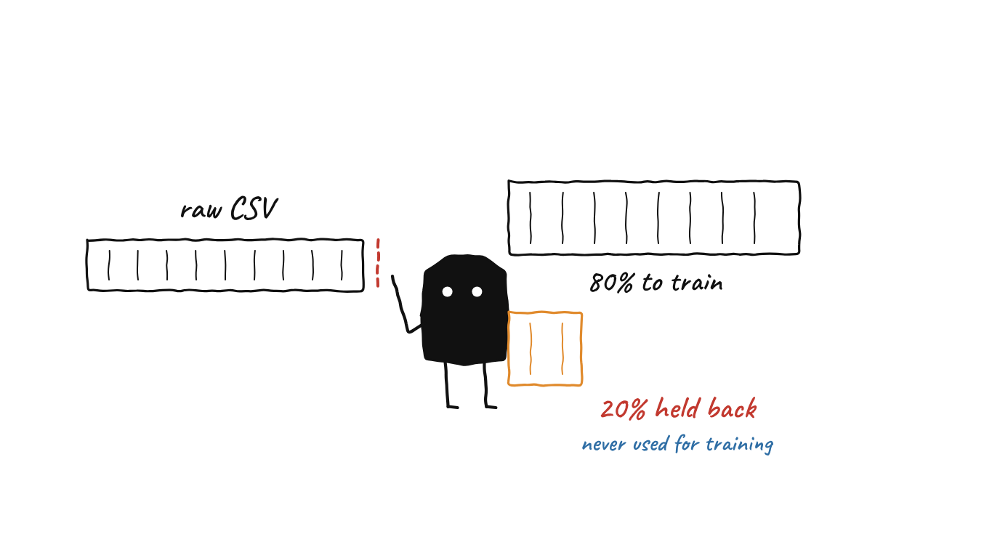
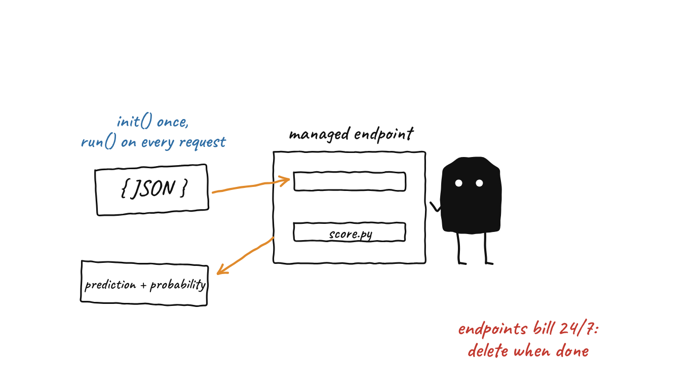

<div align="center">

# Azure ML Pipeline

**A four-step Azure Machine Learning pipeline (SDK v2) that cleans data, trains a model, scores it, and serves it as a REST endpoint.**

   

[What this is](#what-this-is-and-is-not) · [How it works](#how-it-works-start-to-finish) · [Quick start](#quick-start) · [Limitations](#limitations)

</div>

---

## The problem and the approach

A model trained in a notebook and passed around as a pickle file is hard to repeat, trace or serve. This project moves the same lifecycle into Azure Machine Learning so that each stage is a separate, versioned job:

1. **Prepare**: clean the data and split it into train and test sets.
2. **Train**: fit a classifier and log its settings to MLflow.
3. **Evaluate**: score it on data it never saw.
4. **Register check**: confirm the model files exist.
5. **Deploy and score**: register the model, put it behind a managed online endpoint, and answer JSON requests.

## What this is and is not

Read this first. It is the honest scope of the repository.

| Claim you might expect | What the code actually does |
|---|---|
| "Trains on heart-disease data" | `src/run_pipeline.py` uploads `data/heart_disease.csv`. That file is git-ignored and is **not in the repository**. If it is missing, the script **generates 1,000 rows of random numbers with random 0/1 labels** (`np.random.seed(42)`). A model trained on that has nothing to learn. Bring a real dataset with the same 13 feature columns plus `target` if you want meaningful results. |
| "Registers the model only if it meets a threshold" | `components/04_register.py` prints the evaluation metrics and checks that `model.pkl` and `scaler.pkl` exist. **There is no metric threshold and it does not register anything.** |
| "Deploys the model the pipeline just trained" | `python src/run_pipeline.py deploy` registers whatever is in the local `trained_model/` folder (a committed copy is included). It does **not** take the output of the latest pipeline run. If that folder is missing, it trains a demo model on random noise. |
| "Retrains automatically when data drifts" | There is no schedule, trigger or drift monitoring in this repository. The pipeline runs when you run it. |
| "Zero-downtime deployment" | The deployment is one instance named `default` that takes 100% of traffic. This repository does not set up blue/green traffic splitting. |
| "Clinical model" | **No.** It is a demonstration of pipeline mechanics. Do not use it for any medical decision. |

Also worth knowing: the training step logs accuracy and F1 on the **training** data, which says little about generalisation. The honest numbers are the `test_*` metrics from the evaluation step. The committed `artifacts/` folder is the downloaded log of one earlier run that failed inside the training step (an older version of the script called `mlflow.sklearn.log_model`, which the current script does not). There are no automated tests in this repository, and this README was checked against the source code, not by running the pipeline against live Azure resources.

## The three ideas, illustrated

<p align="center">
  <br>
  <sub><b>1 · Clean and split.</b> Eighty percent of the rows train the model. Twenty percent are held back for scoring.</sub>
</p>

<p align="center">
  <br>
  <sub><b>2 · Train and score.</b> A Random Forest is fitted on the training rows, then scored on the held-back rows.</sub>
</p>

<p align="center">
  <br>
  <sub><b>3 · Deploy and answer.</b> The endpoint loads the model once, then answers every JSON request. Delete it when you are done.</sub>
</p>

## The whole system in one picture

<p align="center">
  
</p>

| On the bench | In the pipeline | Code |
|---|---|---|
| Raw slip at the first arch | The raw CSV is cleaned and split 80/20 (stratified on `target`) | `components/01_data_prep.py` |
| Second arch with a press | A Random Forest (100 trees, max depth 10) is trained; scaler and feature names are saved with it | `components/02_train.py` |
| The dial behind the belt | Accuracy, F1, precision, recall and AUC-ROC on the held-out 20%, written to `evaluation_results.json` | `components/03_evaluate.py` |
| Block with two lamps | The register step checks that `model.pkl` and `scaler.pkl` exist | `components/04_register.py` |
| Folder, then the registry cabinet | `deploy` registers the local `trained_model/` folder as a model | `src/run_pipeline.py` `deploy_model()` |
| The `score.py` box | A managed online endpoint on one `Standard_DS2_v2` instance | `components/score.py` |
| Request slip in, response slip out | JSON in, predictions and probabilities out | `score.py` `init()` and `run()` |

Open [`docs/anatomy/ml-pipeline-bench-light.html`](docs/anatomy/ml-pipeline-bench-light.html) in a browser to scrub through it (details in [`docs/anatomy/README.md`](docs/anatomy/README.md)). The dial position and the slip contents are drawn for the picture; no real metric is shown.

## How it works, start to finish

### Phase 1 · The pipeline run (`python src/run_pipeline.py run`)

The run creates a conda environment, registers the dataset, and submits a four-step pipeline job to the compute cluster named in `src/config.py` (`training-cluster`).

| Step | Script | Input | Output | What it does |
|---|---|---|---|---|
| **1. Prepare** | `01_data_prep.py` | raw CSV | `train.csv`, `test.csv` | Drops duplicate rows, fills missing values (median for numbers, most common value for text), then splits 80/20 with `random_state=42`, stratified on `target`. |
| **2. Train** | `02_train.py` | `train.csv` | `model.pkl`, `scaler.pkl`, `features.txt` | Scales features with `StandardScaler`, trains `RandomForestClassifier(n_estimators=100, max_depth=10)`, logs parameters, training accuracy and F1, and feature importances to MLflow. |
| **3. Evaluate** | `03_evaluate.py` | model files, `test.csv` | `evaluation_results.json` | Scores the held-out rows: accuracy, F1, precision, recall, AUC-ROC and a confusion matrix, logged to MLflow. |
| **4. Register check** | `04_register.py` | model files, results | console output | Prints the metrics and checks that the two model files exist. Fails the step if they do not. |

### Phase 2 · Deploy and score (`deploy`, then `test`)

| Step | What happens |
|---|---|
| **Register** | `deploy` registers the local `trained_model/` folder as the model `heart-disease-classifier`. |
| **Create the endpoint** | A managed online endpoint `heart-disease-endpoint` with key authentication. |
| **Create the deployment** | One deployment named `default` on one `Standard_DS2_v2` instance, using `score.py` and the same conda environment. This takes several minutes. |
| **Score** | `init()` loads the model once when the container starts. `run()` parses the JSON, applies the saved scaler, and returns `{"predictions": [...], "probabilities": [...]}`. |

Example request body:

```json
{"input_data": {"columns": ["age", "sex", "cp", "trestbps", "chol", "fbs", "restecg", "thalach", "exang", "oldpeak", "slope", "ca", "thal"],
                "data": [[63, 1, 3, 145, 233, 1, 0, 150, 0, 2.3, 0, 0, 1]]}}
```

## Azure services used

| Service | Purpose | DP-100 topic |
|---|---|---|
| **Azure ML Workspace** | Central hub for all ML resources | Workspace management |
| **Compute Cluster** | Training compute | Compute management |
| **ML Pipelines (SDK v2)** | Orchestrate the four steps | Pipeline design |
| **MLflow** | Experiment tracking and logging | Experiment management |
| **Model Registry** | Version and catalogue models | Model management |
| **Managed Online Endpoints** | Serve the model as a REST API | Model deployment |
| **Environments** | Reproducible Python environment | Environment management |

## Quick start

**1. Create the Azure resources** by following [SETUP_GUIDE.md](SETUP_GUIDE.md) (workspace, a compute cluster named `training-cluster`).

**2. Install locally**

```bash
git clone https://github.com/designer-coderajay/azure-ml-pipeline.git
cd azure-ml-pipeline
python -m venv venv
source venv/bin/activate          # Windows: venv\Scripts\activate
pip install -r requirements.txt
az login
cp .env.example .env              # then fill in your subscription ID, resource group and workspace name
```

**3. Run, deploy, test, clean up**

```bash
python src/run_pipeline.py run       # submit the four-step pipeline; follow it in ML Studio
python src/run_pipeline.py deploy    # register trained_model/ and create the endpoint
python src/run_pipeline.py test      # send two sample patient records
python src/run_pipeline.py cleanup   # delete the endpoint to stop billing
```

## Configuration

Set these in `.env` (template: `.env.example`). Never commit `.env`.

| Variable | Meaning | Default in code |
|---|---|---|
| `AZURE_SUBSCRIPTION_ID` | Your subscription | placeholder text |
| `AZURE_RESOURCE_GROUP` | Resource group | `rg-ml-pipeline` |
| `AZURE_ML_WORKSPACE` | Workspace name | `ml-pipeline-workspace` |

Authentication uses `DefaultAzureCredential` (after `az login`), so there are no keys in the code. The compute cluster name `training-cluster` is a constant in `src/config.py` and must match what you created.

## Project structure

```
azure-ml-pipeline/
├── SETUP_GUIDE.md              # Step-by-step Azure Portal instructions
├── .env.example                # Template for workspace config
├── requirements.txt            # Python dependencies
├── src/
│   ├── config.py               # Azure ML workspace connection
│   └── run_pipeline.py         # Pipeline definition, deploy, test, cleanup
├── components/                 # Scripts that run IN Azure ML
│   ├── 01_data_prep.py
│   ├── 02_train.py
│   ├── 03_evaluate.py
│   ├── 04_register.py
│   └── score.py                # Scoring script for the endpoint
├── trained_model/              # Model, scaler and feature names that `deploy` registers
├── artifacts/                  # Downloaded logs of one earlier, failed run
└── docs/
    ├── anatomy/                # The interactive bench figure (HTML, GIF, PNG) and its build files
    └── illustrations/          # The three README illustrations and their generator
```

`data/heart_disease.csv` is git-ignored and is created or supplied at run time.

## Limitations

- **The sample data is random.** Unless you supply a real dataset, the metrics are meaningless.
- **No metric gate and no automatic registration** in the pipeline; `deploy` ships `trained_model/` by hand.
- **No retraining trigger, drift monitoring or tests.**
- **Training metrics are computed on training data.** Use the `test_*` metrics.
- **Single-instance deployment**, no traffic splitting.
- **`requirements.txt` lists `raiwidgets` and `responsibleai`**, which the code does not use.
- **Not run against live Azure here.** This README was checked against the source, not by executing the pipeline.

## Cost management

Compute clusters with `min_nodes=0` scale down when idle, but **managed online endpoints keep billing until they are deleted**. Always run `python src/run_pipeline.py cleanup` when you are done, and check the Azure pricing pages for current rates.

## Skills demonstrated

Azure ML workspace and compute management · ML pipeline design with SDK v2 · MLflow tracking · model registry · managed online endpoints · conda environments · scoring-script design with input handling and error responses

## License

MIT
